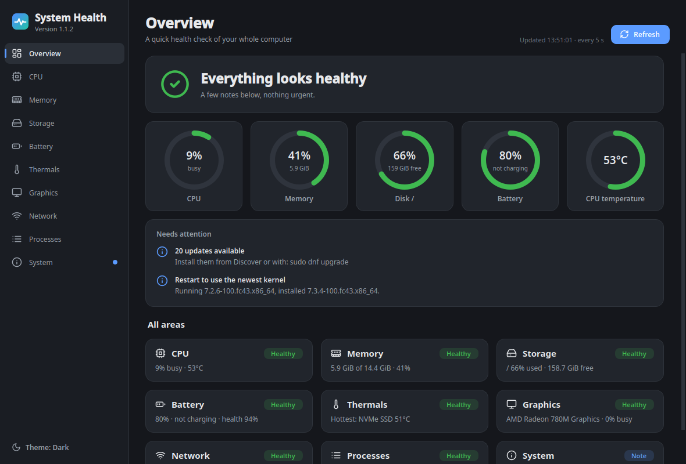
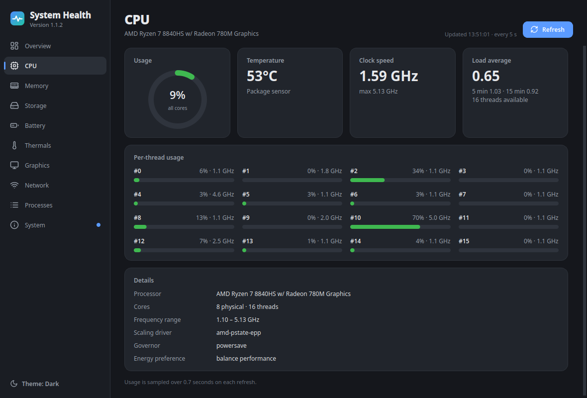
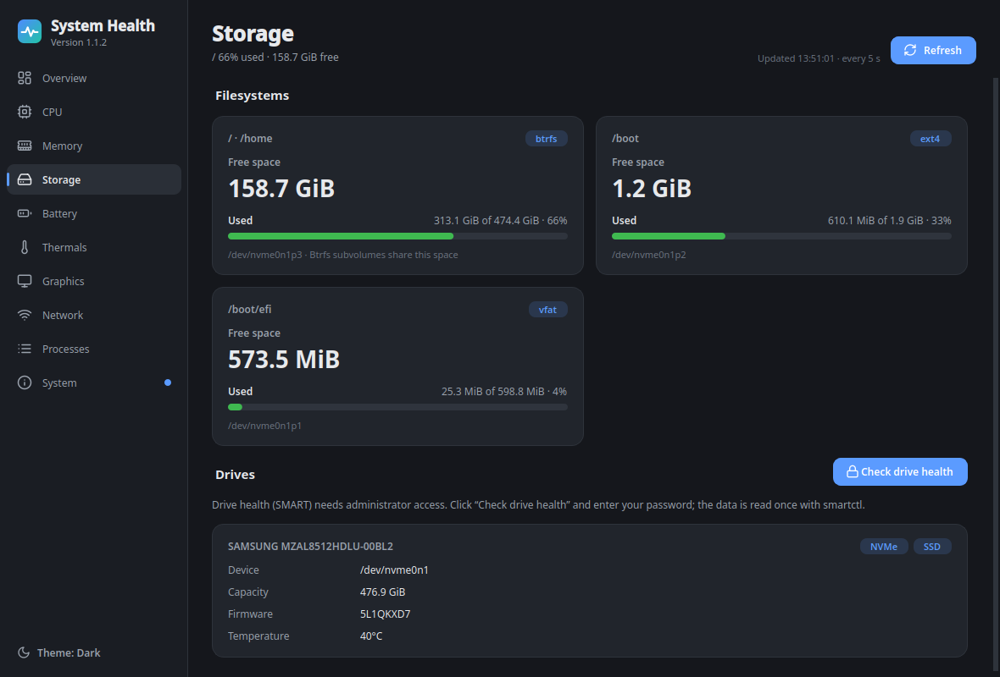
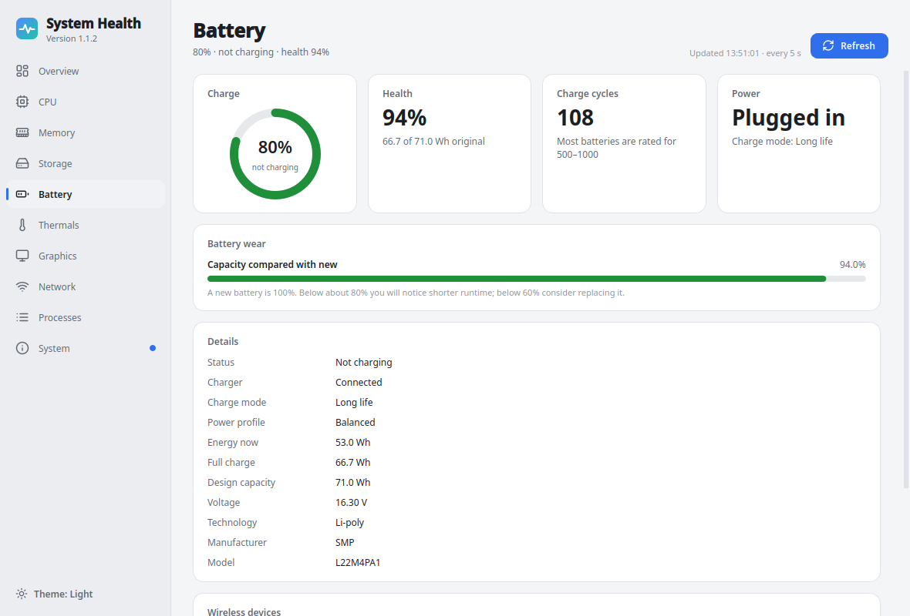
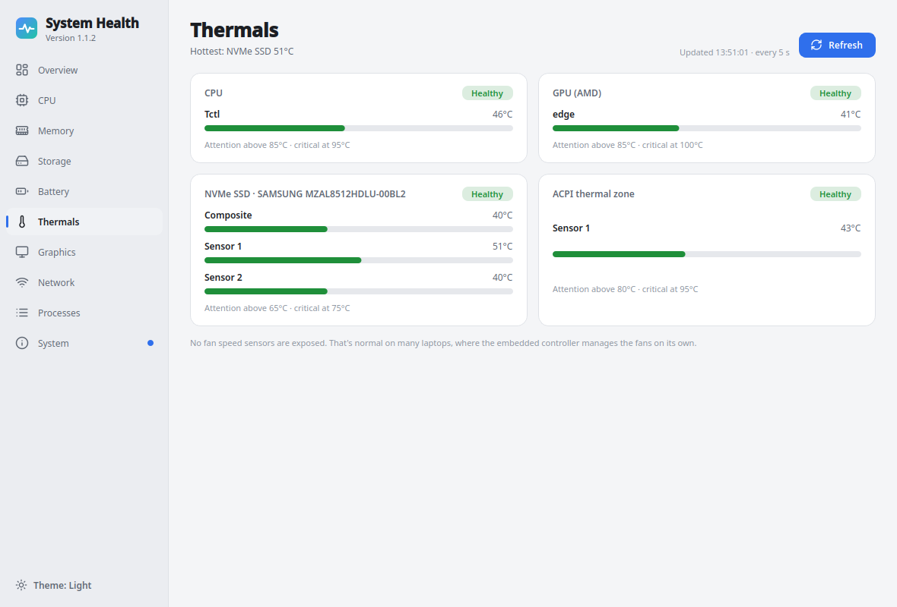

<p align="center">
  
</p>

<h1 align="center">System Health</h1>

<p align="center">
  A clean, modern desktop app that shows how healthy your Linux computer is —<br>
  CPU, memory, disks, battery, temperatures, graphics, network, processes and system status —<br>
  without typing a single terminal command.
</p>

<p align="center">
  
</p>

> **Personal project, provided as-is.** System Health was built for my own use with the help of
> an AI coding assistant (Claude). It works well on my machine, but it has only been tested on one
> computer (see [Limitations](#limitations)). Bug reports are welcome; there is no guarantee of
> support or updates.

## What it does

System Health gathers the information you would normally get from `top`, `free`, `df`,
`smartctl`, `sensors`, `upower`, `nmcli`, `journalctl`, `systemctl` and `dnf`, and shows it
as cards with a simple traffic-light status:

**green** = healthy · **blue** = a note · **amber** = needs attention · **red** = critical

It refreshes automatically **every 5 seconds** while the window is open (paused while
minimized). The slower system checks — pending updates, failed services, journal errors —
re-run every 5 minutes. Press **Refresh** (or <kbd>F5</kbd>) to re-check everything immediately.
Closing the window stops everything; nothing runs in the background.

| Page | What you see |
|---|---|
| **Overview** | One verdict, quick gauges, a list of everything that needs attention, a tile per area |
| **CPU** | Overall and per-thread usage, clock speed, load average, temperature, governor |
| **Memory** | RAM, swap and zram usage; biggest memory users grouped by app |
| **Storage** | Free space per filesystem (Btrfs-aware), drive details, SMART health and SSD wear |
| **Battery** | Charge, wear vs. original capacity, cycles, time left, charge mode, wireless-device batteries |
| **Thermals** | Every temperature sensor and fan, with attention / critical thresholds |
| **Graphics** | GPU usage, clock, power, video memory |
| **Network** | Connectivity, Wi-Fi signal, interfaces, IP addresses, live throughput |
| **Processes** | Sortable, searchable process list; end or force-kill your own processes |
| **System** | Model, firmware, OS, kernel, uptime, pending updates, failed services, recent errors |

It follows your desktop's light/dark preference (or you can pick one in the sidebar).

<p align="center">
  
  
  
  
</p>

## Install & run

### AppImage (recommended)

Download `System_Health-<version>-x86_64.AppImage` from the
[Releases](../../releases) page, then:

```sh
chmod +x System_Health-*-x86_64.AppImage
./System_Health-*-x86_64.AppImage
```

Optional extras:

```sh
./System_Health-*-x86_64.AppImage --install-desktop   # add to your app launcher (re-run if you move the file)
./System_Health-*-x86_64.AppImage --check             # plain-text report in the terminal, no window
sha256sum -c System_Health-*-x86_64.AppImage.sha256   # verify the download
```

### From source

```sh
git clone <this repo> && cd system-health
./run.sh            # creates a virtualenv (.venv) with PySide6 + psutil on first run
./run.sh --check
```

Requires Python 3.10+.

### Build the AppImage yourself

```sh
./build-appimage.sh
```

Freezes the app with PyInstaller and packs it with
[appimagetool](https://github.com/AppImage/appimagetool) into
`dist/System_Health-<version>-x86_64.AppImage` (plus a `.sha256` file).
Needs internet access: pip packages and appimagetool are downloaded on the first build,
and appimagetool fetches the AppImage runtime on every build.

## Limitations

Please read these before relying on the app or sharing it.

**Compatibility**
- **x86_64 only.** No ARM build (e.g. Raspberry Pi, Snapdragon laptops).
- **The AppImage needs glibc 2.39 or newer**, because it was built on Fedora 43.
  It runs on Fedora 40+, Ubuntu 24.04+, Linux Mint 22+, Debian 13, Arch and openSUSE Tumbleweed.
  It will **not start** on Ubuntu 22.04, Debian 12, Mint 21 or RHEL/Alma/Rocky 9.
- **Tested on a single machine** (Lenovo Yoga laptop, AMD Ryzen 7 8840HS / Radeon 780M,
  one NVMe SSD, Fedora 43 KDE on Wayland). Desktops, Intel or NVIDIA graphics, hard drives,
  multi-drive setups, fans and other desktop environments are supported in the code but untested.

**Fedora-specific parts**
- **Pending updates** are counted with `dnf` (plus Flatpak). On Ubuntu, Debian, Arch etc. the
  package count is missing, so the update total only reflects Flatpak (or shows 0).
  The dnf count uses cached metadata and can lag behind until dnf/Discover refreshes it.
- **"Restart to use the newest kernel"** relies on `rpm` and only works on RPM-based distros.
- Atomic desktops (Silverblue, Kinoite, Bazzite…) are detected but get no package update count.

**Features that depend on other tools**
- **Drive health (SMART)** needs `smartmontools` and polkit (`pkexec`). It asks for an admin
  password on each check; the prompt mentions `/bin/sh` because one shell command reads all
  drives at once. Some USB enclosures don't pass SMART data through.
- **Wi-Fi details and connectivity** need NetworkManager (`nmcli`). **GPU names** need `lspci`.
  **NVIDIA** GPU stats need the proprietary driver's `nvidia-smi`; with `nouveau` only basic
  info is shown. Intel GPUs show only clock speed.
- **Fan speeds** only appear if the hardware exposes them; most laptops don't.
- **Journal errors** may be incomplete if your user isn't allowed to read the system journal
  (on Fedora, members of `wheel` can).

**Accuracy & behaviour**
- It is a **snapshot tool, not a monitor**: no history, graphs over time, alerts, notifications
  or tray icon. Values are only collected while the window is open.
- CPU, process and network figures are short samples (0.7–1 s) taken on each refresh, so they
  jump around more than a long-term average would.
- Health thresholds are sensible general defaults (e.g. disk 80 % / 90 %, battery wear 80 % / 60 %,
  CPU 85 °C / 95 °C), not vendor-specific limits. They can be changed in
  `syshealth/collectors/*.py`.
- Process memory is resident memory (RSS); shared memory is counted per process, so app
  totals can be slightly overstated.
- **End process / Force kill** only work on your own processes.
- The Flatpak update check contacts Flathub (every 5 minutes while open). Nothing else is sent
  anywhere — no telemetry, no accounts.
- English only. The AppImage is not code-signed — verify it with the `.sha256` file.

## Project layout

```
syshealth/
  collectors/     one module per area; collect() returns a plain dict + "findings"
  ui/             theme, icons, widgets, pages, main window
  __main__.py     entry point (--check, --install-desktop, --version)
packaging/        PyInstaller spec, AppRun, .desktop file, icon
docs/screenshots/
build-appimage.sh
run.sh
```

Adding a check is usually a few lines: return a `Finding(level, title, detail)` from a
collector and it appears on its page, in the sidebar status dot and on the Overview.

## License

The source code is released under the [MIT License](LICENSE) — use it, change it, share it,
sell it; just keep the copyright notice.

The AppImage also bundles third-party components under their own licenses (notably Qt and
PySide6 under LGPL-3.0). See [THIRD_PARTY_NOTICES.md](THIRD_PARTY_NOTICES.md).
